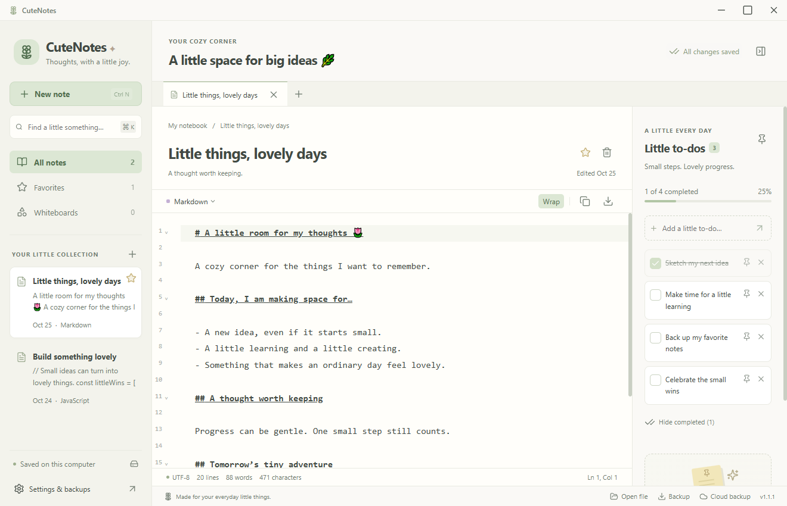
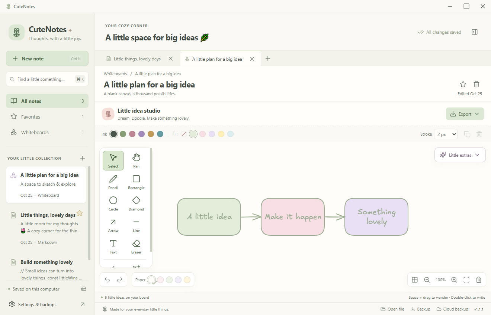
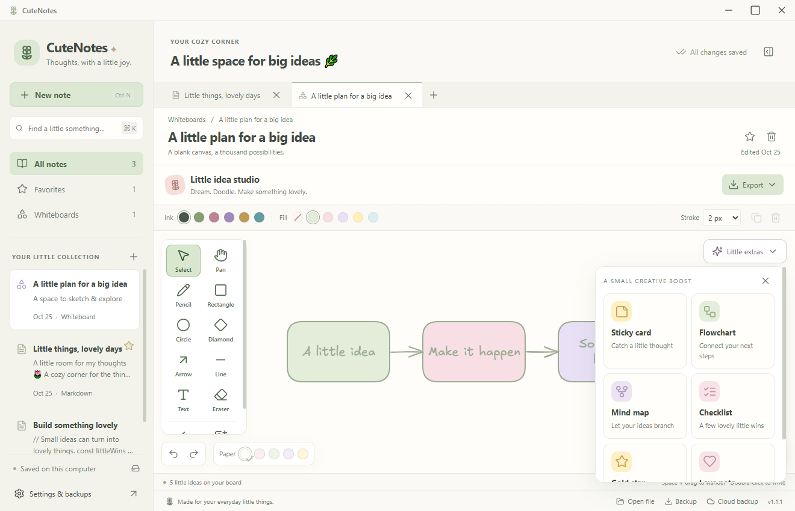
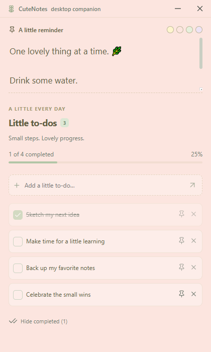

<div align="center">


# Sara Note 🌷

### A little space for notes, doodles & everyday wins.

Bring your thoughts, code, sketches and little to-dos together in one cozy Windows workspace.


**[⬇ Download for Windows](https://github.com/charitha-only/Sara-Note/releases/download/v1.1.1/CuteNotes-Setup-1.1.1.exe)** · **[Latest release](https://github.com/charitha-only/Sara-Note/releases/latest)** · **[Share an idea](https://github.com/charitha-only/Sara-Note/issues)**

</div>



> **A small note about the name:** this project is called **Sara Note**. The current Windows app still opens as **CuteNotes 1.1.1**. Updating the app's name is planned for a future release.

## Your thoughts deserve a lovely little home

Some days you need somewhere to write a thought before it disappears. Other days you want to sketch an idea, save a useful piece of code, or keep a small reminder beside your work.

Sara Note brings those everyday moments together: a tabbed notebook, a pastel drawing studio, a task list and a floating desktop companion. Start with one note. Make a little plan. Keep the next step close.

**No account is required for local notes.** The notebook works offline and saves your changes on your computer. Sinhala and other Unicode text are welcome here too. 🌿

## A peek inside

### 📝 A notebook for words and code

Create several notes, switch between tabs, find an old thought with search and star the ones you want to keep close. Notes save automatically after a short pause, and the save indicator shows their status.

Choose **Markdown, plain text, JavaScript, TypeScript, Python, C/C++, HTML, CSS or JSON** for syntax highlighting. Bring in a UTF-8 text file, copy a snippet or export an individual note when you need it elsewhere.

### 🎨 Little idea studio

A roomy canvas for the things that are easier to draw than explain. Use the custom CuteNotes pencil case, pastel ink and fill colors, paper colors, shapes, arrows, text, a highlighter and your own images.



Open **Little extras** for a small creative boost:

| A little extra | What you can make |
| --- | --- |
| 🌼 Sticky card | A small, editable home for a thought or reminder |
| 🌿 Flowchart | Three connected steps to get an idea moving |
| 💜 Mind map | A central idea with room for four branches |
| ✅ Checklist card | An editable checklist as part of your drawing |
| ⭐ Gold star | A little encouragement for your board |
| 💗 Love note | A heart stamp for something you love |



Double-click card text to make it yours. Duplicate a selection, undo a change, turn on the grid, zoom in, fit the drawing or export it as **PNG or SVG**. SVG exports include the drawing's images and local fonts.

The checklist card is a drawing template. For interactive checkboxes, use the **Little to-dos** panel.

### 📌 A reminder that stays close

Add a few tasks, tick off a little win and pin a reminder to your desktop. The floating companion stays above your other windows, with a free-text sticky note, four paper colors and the shared task list.

<div align="center">

</div>

### 💾 Your notebook, packed up neatly

Export your notes, drawing scenes, embedded images, tasks and sticky note into one compressed **`.cutenote` backup**. Restore it later with **Merge** or **Replace**. A local recovery copy is saved before a restore.

Optional **Google Drive backup** is available for users who configure their own Google Desktop OAuth client. It backs up the notebook to the account's private app data folder; cloud restore is a deliberate action. It is a backup feature, rather than automatic conflict-resolving collaboration between several computers. [Google Drive setup →](docs/DEVELOPMENT.md#optional-google-drive-backup)

## Download & settle in

1. **[Download CuteNotes-Setup-1.1.1.exe](https://github.com/charitha-only/Sara-Note/releases/download/v1.1.1/CuteNotes-Setup-1.1.1.exe)** from this project's GitHub release.
2. Open the installer and choose where to install the app.
3. Launch **CuteNotes** from the desktop or Start menu, and make your first little note.

**For Windows 10/11, 64-bit.** The installer includes the app runtime and drawing assets. You do not need to install Node.js, Rust, C++ 2010 or DirectX 9 separately. Installation and the local notebook do not require an internet connection; Google sign-in and cloud backup do.

The current installer is unsigned, so Windows may display an unknown-publisher notice. This is an early desktop release. Screenshots on this page use sample notes and tasks to show the app in use.

## A few useful shortcuts

| Do a little thing | Shortcut |
| --- | --- |
| New note | `Ctrl N` |
| New whiteboard | `Ctrl Shift N` |
| Save now | `Ctrl S` |
| Open a text/code file | `Ctrl O` |
| Find a note | `Ctrl K` |
| Undo / redo a drawing change | `Ctrl Z` / `Ctrl Shift Z` |

## More lovely things are on the way ✨

**More updates are planned.** This is the start of Sara Note, and there is room for it to grow with the people who use it.

- [ ] Bring the **Sara Note** name into the installed app and installer.
- [ ] Make the Windows download smaller while keeping the local experience.
- [ ] Keep improving readability, spacing and the little details of the interface.
- [ ] Refine the drawing tools and add useful creative extras.
- [ ] Improve backup setup and everyday reliability.
- [ ] Shape future changes around feedback and real use.

These are plans, not features already included or promises of a particular release date. Found a rough edge, or have an idea that would make your day easier? **[Open an issue](https://github.com/charitha-only/Sara-Note/issues)** and help shape the next little update.

## Local by default

Notes are stored in a local SQLite database. Google Drive is optional. Backup files exclude Google credentials and tokens; the backup file itself is not encrypted. Keep a copy somewhere you trust before making major changes to your notebook.

Use **Settings → Open local data folder** to find the notebook on your computer. [Backup, restore and recovery details →](docs/DEVELOPMENT.md#back-up-your-notebook)

## For curious builders

Built with **Electron, React, TypeScript, CodeMirror, Zustand, SQLite (sql.js)** and an **Excalidraw drawing engine with a custom interface and additional tools**.

```powershell
git clone https://github.com/charitha-only/Sara-Note.git
cd Sara-Note
npm ci
npm run build
npm start
```

Use `npm test` for the storage/service checks and `npm run dist` to build a Windows installer. The detailed setup, optional cloud configuration, limits and recovery instructions are in the **[developer & user guide](docs/DEVELOPMENT.md)**. Existing verification is documented in **[TEST-RESULTS.md](TEST-RESULTS.md)**.

### A little credit where it belongs

Sara Note uses open-source components. Excalidraw's [MIT copyright and permission notice](licenses/Excalidraw-MIT.txt) is retained in the source and installed distribution. Bundled dependencies retain their applicable notices. This repository does not grant a separate blanket license for the original application code.

---

<div align="center">

Made for your everyday little things. 🌷  
**Write a thought. Sketch a possibility. Take one lovely little step.**

</div>
